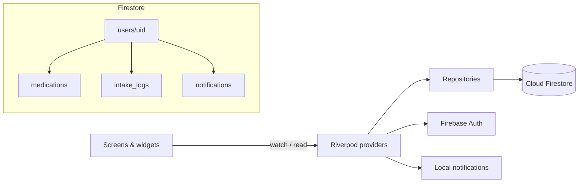

# MedCare

A Flutter app that helps people with chronic conditions take their medication on time, and lets a family member keep an eye on things from their own phone.

## Context

I built MedCare as a personal/academic project while studying engineering at ENIT (École Nationale d'Ingénieurs de Tunis). I started from a simple observation: many patients on long-term treatment forget doses, and their relatives often have no idea until it becomes a problem. So the app is built around two roles, the **patient** who takes the medication and the **caregiver** who follows along.

The interface is available in French (default) and English.

## Features

**For the patient**
- Add medications with name, dose, frequency (once, twice or three times a day), intake times and a colour tag
- Daily local reminders at each scheduled time (`flutter_local_notifications` + `timezone`)
- Mark each dose as taken or missed, and log how you feel (😊 / 😐 / 😔) when you take it
- Analytics screen: weekly bar chart, monthly calendar view, adherence rate and a list of missed doses
- Export a weekly PDF report and share it (e.g. with a doctor)
- A built-in assistant, "MedAssist", that answers common questions (missed dose, side effects, storage, interactions…) using keyword-based rules, and always points back to a doctor or pharmacist

**For the caregiver**
- Each patient gets a unique family code. The caregiver enters it to link their account
- See the patient's medication list and intake history
- Receive in-app notifications when the patient takes or misses a dose
- Generate the same PDF report from the caregiver side

**General**
- Email/password sign-up with role selection (patient or caregiver), and a dedicated navigation bar for each role
- Onboarding flow, light/dark theme, language switch
- Offline support: Firestore's local cache keeps the app usable without a network, with a banner and a retry button

## Tech stack

| | |
|---|---|
| Framework | Flutter, Dart |
| State management | Riverpod |
| Navigation | go_router (auth- and role-aware redirects) |
| Backend | Firebase Authentication, Cloud Firestore |
| Notifications | flutter_local_notifications, timezone |
| Charts & reports | fl_chart, pdf, printing |
| Other | shared_preferences, google_fonts, flutter_animate, intl |

## Architecture

The code is organised by feature. Each feature has its own `data` (models and Firestore repositories), `providers` (Riverpod) and `screens`/`widgets` folders.

```
lib/
├── main.dart              # Firebase init (with retry), offline banner, root widget
├── core/
│   ├── l10n/              # FR / EN strings
│   ├── providers/         # app-wide providers (onboarding)
│   ├── router/            # go_router config, patient & caregiver shells
│   └── theme/             # light/dark themes
└── features/
    ├── auth/              # login, register, user document
    ├── medications/       # medication CRUD, intake logs, home screen
    ├── notifications/     # local reminder scheduling
    ├── analytics/         # charts, calendar, adherence
    ├── family/            # family-code linking, caregiver screens, notifications
    ├── mood/              # mood tracking at intake
    ├── report/            # PDF generation
    ├── chatbot/           # rule-based assistant
    ├── onboarding/
    ├── profile/
    └── settings/
```



When a dose is marked as taken or missed, the app writes a notification into the linked caregiver's `notifications` subcollection. The caregiver's app listens to it in real time.

## Screenshots

| Onboarding | Patient home | Analytics |
|---|---|---|
| _coming soon_ | _coming soon_ | _coming soon_ |

| Caregiver home | PDF report | MedAssist |
|---|---|---|
| _coming soon_ | _coming soon_ | _coming soon_ |

<!-- Add images to a docs/screenshots/ folder and reference them like:
 -->

## Getting started

### Prerequisites

- Flutter SDK with Dart `^3.11.5` (`flutter --version`)
- A Firebase project with **Authentication (Email/Password)** and **Cloud Firestore** enabled
- An Android emulator/device (the main target), or iOS / web / Windows

### 1. Clone and install dependencies

```bash
git clone https://github.com/chaimaelakremi/MedCare.git
cd MedCare
flutter pub get
```

### 2. Configure Firebase

The Firebase configuration files are not committed. You need to generate your own from your Firebase project. The repository only contains example files with placeholder values:

| Example file | Real file to create (git-ignored) |
|---|---|
| `lib/firebase_options.example.dart` | `lib/firebase_options.dart` |
| `android/app/google-services.example.json` | `android/app/google-services.json` |
| `firebase.example.json` | `firebase.json` |

**Recommended: use the FlutterFire CLI**, which creates all three files for you:

```bash
dart pub global activate flutterfire_cli
flutterfire configure
```

**Manual alternative:** copy each example file to its real name and replace the placeholders (`YOUR_..._API_KEY`, `your-project-id`, `1:000000000000:...`) with the values from *Firebase console → Project settings → Your apps*. You can download `google-services.json` directly from that page.

> The app imports `lib/firebase_options.dart`, so it won't compile until this file exists.

### 3. Run

```bash
flutter run
```

If Firebase can't be reached on startup, the app retries three times and then opens in offline mode.

## Author

**Chaima Elakremi**, engineering student at ENIT

- LinkedIn: [chaima-elakremi](https://www.linkedin.com/in/chaima-elakremi-748004332/)
- GitHub: [@chaimaelakremi](https://github.com/chaimaelakremi)

## License

This project is released under the [MIT License](LICENSE).

MedCare is a student project and is not a medical device. It does not replace advice from a doctor or pharmacist.
